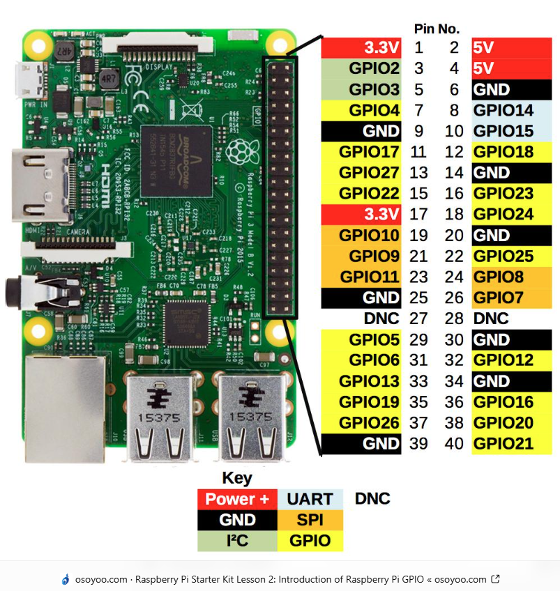

# Câblage de l'allsky : capteurs et chauffage

Document de référence pour le câblage matériel : broche par broche, ce qui est branché où, et dans quel ordre
mettre sous tension. Les réglages logiciels correspondants sont dans le [README](README.md) et dans
`allsky-sensors.env.example`.

Trois principes, à ne jamais perdre de vue :

1. **Tout est en 3,3 V côté capteurs** (l'I2C et le 1-Wire de la Pi ne supportent pas 5 V).
2. **La Pi est alimentée en PoE** ; le chauffage est alimenté séparément, par la **prise USB-A 5 V du HAT PoE**,
   jamais par les broches 5 V du connecteur de 40 broches.
3. **Le programme refuse les broches déjà prises** (I2C 2 et 3, 1-Wire 4, plus `GPIO_RESERVED`) : une erreur de
   câblage se voit donc au démarrage, pas après.

## Vue d'ensemble

```
   BME280 ─────────────────┐
   MLX90614 ───────────────┤ I2C : SDA broche 3, SCL broche 5 ────┐
   DS18B20 ────────────────┘ 1-Wire : DQ broche 7, + 4,7 kΩ       │
                                                                  │
                    ┌─────────────────────────────────────────────┘
                    │  Pi 3 B+ (alimentée en PoE, câbles par-dessus le HAT)
                    └── broche 16 ──► IN du module MOSFET            (PWM à 100 Hz)
                    └── broche 14 ──► GND du module MOSFET           (masse commune avec le 5 V)
                    └── 5 V de la prise USB-A du HAT ──► V+ du module, via un fusible de 1 A
                                                          │
   Le module MOSFET commute les 6 × 47 Ω 1 W (en parallèle) entre ce 5 V et la masse : ◄── c'est tout le chauffage.
```

## Le connecteur 40 broches : ce qui est utilisé ici

| Broche | GPIO | Usage | Remarque |
|---|---|---|---|
| 1 et 17 | — | 3,3 V | alimentation des trois capteurs (VDD/VCC) |
| 3 | GPIO 2 | SDA (I2C) | BME280 **et** MLX90614 sur ce même fil |
| 5 | GPIO 3 | SCL (I2C) | idem |
| 6, 9, 14, 20, 25, 30, 34, 39 | — | GND | masses des capteurs ; la 14 sert de référence au signal PWM |
| 7 | GPIO 4 | 1-Wire (DQ du DS18B20) | avec 4,7 kΩ vers 3,3 V |
| 16 | GPIO 23 | entrée PWM du module MOSFET | voisine de la masse (14) : bon pour la boucle de commande |
| 2 et 4 | — | 5 V | **à ne pas utiliser** : le chauffage passe par la prise USB-A du HAT |
| 11, 12, 13, 15 | 17, 18, 22, 27 | occupées par le focuser | ne pas y toucher (`GPIO_RESERVED`) |

Le HAT PoE reprend le connecteur 40 broches de façon empilable : tes câbles se branchent par le dessus.



*Brochage du connecteur 40 broches, vu de dessus : broches 1 et 2 en haut, impaires à gauche, paires à droite.
Image : osoyoo.com (« Raspberry Pi Starter Kit Lesson 2 »).*

## Les capteurs

### BME280 (extérieur, I2C — adresse 0x76 ou 0x77)

| Module | Pi |
|---|---|
| VIN / VCC / 3V3 | broche 1 ou 17 (3,3 V) |
| GND | broche 6, 9, 14, 20, 25, 30, 34 ou 39 |
| SDA | broche 3 (GPIO 2) |
| SCL / SCK | broche 5 (GPIO 3) |

- Beaucoup de modules vendus comme BME280 sont des BMP280 : ils fonctionnent, mais **sans humidité** (donc sans point
  de rosée, et le chauffage devient inutilisable). `--dry-run --once` le dit tout de suite : `outdoor_humidity` manque.
- À placer dans un abri ventilé, à l'ombre (sinon la température monte de plusieurs degrés au soleil).
- Au-delà d'un à deux mètres de câble, l'I2C devient capricieux : garde le bus court.

### MLX90614 (température du ciel, I2C — adresse 0x5A)

| Module | Pi |
|---|---|
| VCC / 3V3 | broche 1 ou 17 (3,3 V) |
| GND | une broche GND |
| SDA | broche 3 (GPIO 2) — **le même fil que le BME280** |
| SCL | broche 5 (GPIO 3) — idem |

- Le MLX90614 est un composant **3,3 V** : alimente-le en 3,3 V (les modules vendus « 5 V » embarquent un régulateur,
  mais 3,3 V convient dans tous les cas). Sur un boîtier nu (TO-39), repère les broches sur le datasheet Melexis avant
  de souder : **une inversion d'alimentation le détruit**.
- **Sa face optique (le dessus du boîtier métallique) doit voir le ciel.** Plexiglas et verre sont opaques à
  l'infrarouge lointain (8-14 µm) : sous le dôme, il mesurerait la paroi du dôme, pas le ciel. Il doit donc regarder
  par une ouverture, ou derrière une fenêtre transparente à l'IR (film polyéthylène ou polypropylène très fin).
- **Ce qui le réchauffe fausse la mesure** : il se sert de sa propre température comme référence. Évite le soleil
  direct, le boîtier fermé, l'électronique juste à côté et une monture métallique chaude. Il doit être à l'abri de la
  pluie (une visée mouillée ne mesure plus rien).
- Ne monte **jamais** le bus I2C à 400 kHz (n'ajoute pas `dtparam=i2c_arm_baudrate=400000` dans
  `/boot/firmware/config.txt`) : ce capteur ne fonctionne qu'à 100 kHz, la vitesse par défaut.

### DS18B20 (dans le dôme, 1-Wire — GPIO 4)

Boîtier TO-92 : face plate vers toi, pattes vers le bas.

```
   face plate vers toi, pattes vers le bas
            ┌───────────┐
            │  DS18B20  │
            └─┬───┬───┬─┘
              │   │   │
             GND  DQ  VDD
              │   │   │
              │   │   └─────────────────► 3,3 V (broche 1)
              │   │
              │   └───┬─────────────────► broche 7 (GPIO 4)
              │       │
              │    4,7 kΩ
              │       │
              │       └─────────────────► 3,3 V (broche 17)
              │
              └───────────────────────────► GND (broche 6, 9, 14…)
```

- La résistance de **4,7 kΩ entre DQ et 3,3 V** est obligatoire (une seule résistance pour toute la ligne 1-Wire, même
  avec plusieurs sondes).
- **Une inversion d'alimentation le fait chauffer et le détruit** : vérifie deux fois avant de brancher. Si la sonde
  chauffe, débranche immédiatement.
- Pour mesurer ce qui compte (la surface qui condense), fixe-le **contre la paroi intérieure du dôme** (ruban adhésif ou
  colle thermique) plutôt que dans l'air du dôme.

### Le bus I2C en commun

Les deux capteurs I2C partagent SDA, SCL et l'alimentation : rien à configurer côté logiciel (le programme ouvre le bus
une seule fois et le partage). Chaque module a ses propres résistances de tirage : leur mise en parallèle ne pose pas de
problème. Si tu soudes deux fils sur une même broche, torsade chaque signal avec un GND et garde le tout court.

## Le chauffage

### Le module MOSFET

| Module | Vers |
|---|---|
| IN (ou PWM / SIG) | **GPIO 23, broche 16** de la Pi |
| GND (masse logique) | **GND de la Pi, broche 14** (voisine du signal) |
| V+ (ou VIN, alimentation de la charge) | **5 V** de la prise USB-A du HAT, **après le fusible de 1 A** |
| Sortie « charge » (`-`, `OUT` ou `DRAIN` selon les modules) | un côté des résistances ; l'autre côté va au 5 V |

```
 5 V ──[fusible 1 A]──┬────────────────────────────────┐
                      │                                │
                      └── [6 × 47 Ω 1 W //] ──────────┴──► sortie « charge » du module
 GND du 5 V ──► GND du module   (le MOSFET du module relie cette sortie au GND)
 GPIO 23 (broche 16) ──► IN du module, PWM à 100 Hz
 broche 14 de la Pi ──► le même GND (masse commune)
```

- **Vérifie la fiche du module** : entrée compatible avec un signal **3,3 V** (beaucoup de modules du commerce sont
  prévus pour 5 V — avec un IRF520 ou un optocoupleur, la sortie peut ne pas commuter franchement), et PWM à 100 Hz.
  S'il porte un optocoupleur, vérifie **le sens de commande** (entrée haute = charge alimentée, ou l'inverse) avant de
  le brancher à la Pi.
- La charge est **purement résistive** : pas besoin de diode de roue libre (contrairement à un moteur ou à un relais).
- Si le module n'a pas de résistance de tirage interne, ajoute **10 kΩ entre IN et GND** : le MOSFET reste bloqué quand
  la Pi démarre ou plante.
- La PWM est **logicielle** (GPIO 23 n'a pas de PWM matériel) : sans importance à 100 Hz. Si le programme est tué, le
  signal s'arrête avec lui.
- Si tu changes `HEATER_GPIO`, évite GPIO 2, 3, 4 (I2C et 1-Wire) et ceux du focuser ; `GPIO_RESERVED` fait refuser les
  broches indiquées.

### Les résistances

- 6 résistances de **47 Ω / 1 W en parallèle** = 7,83 Ω : **0,64 A et 3,2 W** sous 5 V à 100 %, avec un rapport
  cyclique plafonné à 94 % par le programme (3,0 W, soit 0,5 W par résistance).
- Chaque résistance dissipe au plus la moitié de son nominal ; pour plus de puissance, il suffit d'en ajouter
  (+0,5 W chacune, voir le tableau du [README](README.md)).
- Fixe-les solidement, loin des câbles et du plastique fragile : elles chauffent, et le montage doit rester immobile.

## L'alimentation du chauffage

- **Source** : la prise USB-A 5 V / 4 A du HAT PoE, prévue pour alimenter des périphériques. Ne passe **ni** par les
  broches 5 V du connecteur de 40 broches **ni** par l'entrée micro-USB de la Pi.
- **Raccordement** : connecteur USB-A à bornes, ou câble USB sacrifié — rouge = +5 V, noir = GND, les deux fils de
  données coupés et isolés.
- **Fusible de 1 A** tout près de la prise USB : la source peut fournir jusqu'à 4 A, et les fils fins d'un câble USB
  chaufferaient bien avant que la protection du HAT n'intervienne en cas de court-circuit.
- **Masse commune** : celle de la prise USB-A l'est déjà (même convertisseur du HAT). Si tu utilises une autre
  alimentation pour le chauffage, relie **impérativement** son GND à un GND de la Pi, sinon la PWM n'a pas de référence.
- **Condensateur de 470 à 1000 µF** près du module si la Pi voit une sous-tension à l'enclenchement.

| Élément alimenté par le HAT | Consommation |
|---|---|
| Pi 3 B+ | 3 à 5 W |
| Caméra USB | jusqu'à 2,5 W |
| Chauffage (5 V, 94 % au plus) | 3,2 W |
| **Total** | **9 à 11 W, soit 2 à 3 A en 5 V** |

Limites du HAT (type Waveshare PoE HAT (C), 802.3af/at) : sortie USB-A 5 V / 4 A au maximum, header 12 V / 2 A (non
utilisé ici), 25 W au total pour le 5 V et le 12 V, et un convertisseur MP8676 limité à 4,5 A pour la Pi **et** la prise
USB-A ensemble. Côté switch (TL-SG1005P) : quatre ports PoE+ (le 5e n'en a pas), environ 12 à 14 W demandés par la Pi.

## Avant de mettre sous tension

- `sudo raspi-config` → Interface Options : active **I2C** et **1-Wire**, puis redémarre.
- Rien n'est branché sur les broches 2 et 4 (5 V), ni sur 11, 12, 13 et 15 (focuser).
- Sens du DS18B20 vérifié (GND, DQ, VDD) et 4,7 kΩ entre DQ et 3,3 V.
- Module MOSFET **hors tension** pendant le câblage : masse commune reliée, 10 kΩ entre IN et GND s'il n'en a pas,
  fusible en place près de la prise USB.
- Visée du MLX90614 dégagée : ni plexiglas, ni vitre, ni goutte d'eau devant la face optique.
- Câbles I2C courts, et **pas** de bus à 400 kHz.

## Mise sous tension, dans l'ordre

```
sudo apt install i2c-tools
i2cdetect -y 1                                                          # 76 ou 77 (BME280) et 5a (MLX90614)
ls /sys/bus/w1/devices/                                                 # 28-… (DS18B20)
cd /opt/allsky-sensors
./venv/bin/python allsky_sensors_mqtt.py --simulate --dry-run --once    # sans matériel ni broker
./venv/bin/python allsky_sensors_mqtt.py --dry-run --once               # vrais capteurs, sans broker
./venv/bin/python allsky_sensors_mqtt.py --print-topics                 # liste à coller dans indi-allsky
```

Puis le chauffage, avec `HEATER_ENABLED=1` et `HEATER_SUPPLY_VOLTS=5` dans l'environnement :

1. **charge débranchée** : `--heater-test 50` pendant 10 s → la sortie du module doit commuter (LED ou multimètre) ;
2. **charge branchée** : `--heater-test 20` → les résistances doivent tiédir, pas chauffer ;
3. `vcgencmd get_throttled` doit répondre `throttled=0x0` ; sinon la Pi a vu une sous-tension (condensateur, ou source
   plus franche).

## Erreurs fréquentes

| Symptôme | Cause probable | Quoi faire |
|---|---|---|
| `capteur bme280 indisponible` | I2C non activé, câblage, adresse | `i2cdetect -y 1` doit montrer 76 ou 77 ; sinon activer l'I2C, refaire les soudures, corriger `BME280_ADDRESS` |
| rien à l'adresse `5a` | module « 3 V » alimenté en 5 V, SDA/SCL inversés, câble trop long | vérifier l'alimentation en 3,3 V, refaire les soudures, raccourcir le bus |
| `sky_temperature` presque égale à `outdoor_temperature` | le capteur voit le dôme, un mur, le sol ou lui-même | le braquer vers le ciel, dégager sa face optique |
| valeur du ciel figée, ou −273,15 °C dans le journal | visée mouillée, capteur non alimenté | sécher, protéger de la pluie, vérifier l'alimentation |
| `capteur ds18b20 indisponible` | 1-Wire non activé, sonde absente, mauvais sens | voir la section « Essais » du [README](README.md) |
| le DS18B20 chauffe | alimentation inversée | **débrancher tout de suite**, puis remettre GND, DQ, VDD dans l'ordre |
| rien ne commute au `--heater-test` | module prévu pour 5 V piloté en 3,3 V, masse non reliée, optocoupleur | vérifier la masse commune, mesurer l'entrée IN, changer de module si besoin |
| la Pi redémarre pendant la chauffe | appel de courant, sous-tension | fusible 1 A, condensateur de 470 à 1000 µF, `vcgencmd get_throttled` |
| le programme refuse de démarrer | `HEATER_GPIO` sur une broche réservée (2, 3, 4 ou `GPIO_RESERVED`) | choisir un GPIO libre |

Pour tout le reste (broker Mosquitto, lancement automatique, réglages du chauffage et d'indi-allsky), voir le
[README](README.md).
